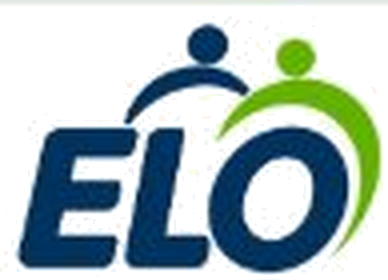

# ELO • Conectando quem cuida da cidade

<p align="center">
  
</p>

<p align="center">
  <strong>Saúde, cuidado e reconhecimento para quem faz a diferença todos os dias.</strong><br>
  Projeto desenvolvido para o <strong>3º Hackathon em Saúde</strong> • Centro Universitário São Camilo & Instituto Mauá de Tecnologia (IMT).
</p>

<p align="center">
  
  
  
  
</p>

---

## 📌 Sobre o Projeto

O **ELO** é uma plataforma que conecta os **trabalhadores da limpeza urbana (garis e coletores)**, os **moradores da cidade** e os **gestores públicos/concessionárias**.

Diariamente, garis enfrentam condições severas de trabalho: riscos de cortes com vidros e agulhas descartados incorretamente, lesões ergonômicas (LER/DORT) e invisibilidade social. O **ELO** foi criado para transformar essa realidade unindo **saúde ocupacional**, **tecnologia de prevenção de acidentes** e **engajamento comunitário**.

---

## 👥 Os Três Pilares da Plataforma

O ELO atua de ponta a ponta com três interfaces integradas:

### 1. 👷🏽‍♂️ Sou Trabalhador (Gari / Coletor)
* **Check-in de Bem-Estar e Dor:** Monitoramento diário de cansaço e queixas físicas (lombar, joelhos, ombros) com triagem preventiva de saúde.
* **Saúde & Ergonomia:** Guias rápidos de alongamento antes e depois do turno para prevenir lesões.
* **Alertas de Rota em Tempo Real:** Avisos antecipados de resíduos perigosos ou cortantes reportados por moradores na rota do caminhão.
* **Economia dos ELOs:** Pontos conquistados por rotas seguras e autocuidado, trocados por benefícios reais (recargas de celular, lanches em padarias parceiras e atendimentos de saúde preventiva).
* **Mural da Comunidade:** Recados de apoio e carinho enviados pelos munícipes, com opção de leitura em áudio.

### 2. 🏠 Sou Morador (Cidadão)
* **Alerta de Resíduos Perigosos:** Reporte ágil de cacos de vidro soltos, seringas ou lixo acumulado, evitando que coletores se firam.
* **Aprenda sobre Descarte Seguro:** Vídeos educativos e tutoriais passo a passo de como embalar vidros e agulhas com segurança.
* **Meu Bairro & Coleta:** Visualização de horários e rotas dos caminhões via mapa interativo.
* **Valorize a Equipe:** Envio de mensagens de incentivo e agradecimento aos profissionais da sua rua.
* **Gamificação Cidadã:** Ganho de ELOs por alertas confirmados e descarte correto, com vantagens comunitárias e desconto no IPTU Verde.

### 3. 🏛️ Painel Web da Concessionária & Prefeitura (B2B/B2G & ESG)
* **Gestão de Saúde Ocupacional (SST/SESMT):** Termômetro de bem-estar da frota e mapeamento de dores corporais por rota.
* **Gestão de Ocorrências:** Tabela e mapa em tempo real sincronizados via Supabase com status de risco (*Vidro*, *Perfurocortante*, *Entulho*).
* **Indicadores ESG & ROI:** Redução de sinistros, queda nos afastamentos previdenciários (INSS) e diminuição do Fator Acidentário de Prevenção (FAP).

---

## ♿ Acessibilidade Universal por Voz

Projetado para garantir inclusão digital completa a trabalhadores e moradores em qualquer condição de letramento:
* **Leitura da Tela em Voz Alta:** O botão global no cabeçalho resume e lê o conteúdo de cada tela utilizando a Web Speech API nativa.
* **Seletor de Voz:** Alternância entre vozes neurais naturais feminina e masculina.
* **Design de Alto Contraste:** Botões grandes, textos legíveis e feedback tátil/sonoro para operações em campo.

---

## 🛠️ Tecnologias Utilizadas

* **Frontend:** HTML5 semântico, CSS3 (variáveis, layout flex/grid, micro-animações, design responsivo) e JavaScript ES6+ nativo (Vanilla).
* **Banco de Dados & Backend as a Service:** [Supabase](https://supabase.com/) com PostgreSQL na nuvem (tabelas `profiles`, `checkins`, `ocorrencias`, `vouchers`).
* **Mapas Georreferenciados:** [Leaflet.js](https://leafletjs.com/) & OpenStreetMap.
* **Síntese de Voz:** Web Speech API (`SpeechSynthesis`).

---

## 🚀 Como Executar o Projeto Localmente

Por ser desenvolvido com tecnologias web nativas e bibliotecas via CDN, **não requer instalação de dependências pesadas** (Node.js/npm são opcionais).

### Pré-requisitos
* Um navegador web moderno (Google Chrome, Edge, Firefox, Safari).

### Passo a Passo

1. **Clone o repositório:**
   ```bash
   git clone https://github.com/LucasCecareli/Hackaton-Maua-SaoCamilo.git
   cd Hackaton-Maua-SaoCamilo
   ```

2. **Abra o projeto:**
   * Basta dar um duplo clique no arquivo `index.html` para abrir diretamente no seu navegador, **OU**
   * Usar uma extensão como o *Live Server* no VS Code, **OU**
   * Iniciar um servidor HTTP simples com Python:
     ```bash
     python -m http.server 8000
     ```
     Depois, acesse no navegador: `http://localhost:8000`

---

## 📂 Estrutura de Arquivos

```
Hackaton-Maua-SaoCamilo/
├── assets/                       # Recursos visuais e mídias
│   ├── logo_elo_hd.png           # Logo oficial ELO em alta definição
│   ├── illustration_hero_hd.png  # Arte oficial da tela inicial
│   ├── worker_3d_hd.png          # Personagem 3D do coletor
│   └── videos/                   # Vídeos educativos de descarte seguro
├── app.js                        # Lógica da aplicação SPA, acessibilidade e rotas
├── index.html                    # Estrutura de todas as telas da aplicação
├── style.css                     # Identidade visual, design system e responsividade
├── supabase.js                   # Conexão e queries com o banco de dados Supabase
└── supabase-schema.sql           # Script SQL para criação das tabelas no PostgreSQL
```

---

## 👥 Equipe de Desenvolvimento

Projeto concebido e desenvolvido por:

* **Alana Silva Santos**
* **Gabriel de Salve**
* **Gabriela Kato Rodrigues Lourenço**
* **Guilherme Volpolini**
* **Lucas Cecareli Ribeiro**

---

## 🏆 Realização

Projeto desenvolvido para o **3º Hackathon em Saúde**:
* **Centro Universitário São Camilo** (Foco em Saúde, Enfermagem e Bem-Estar)
* **Instituto Mauá de Tecnologia - IMT** (Foco em Engenharia, Tecnologia e Inovação)
